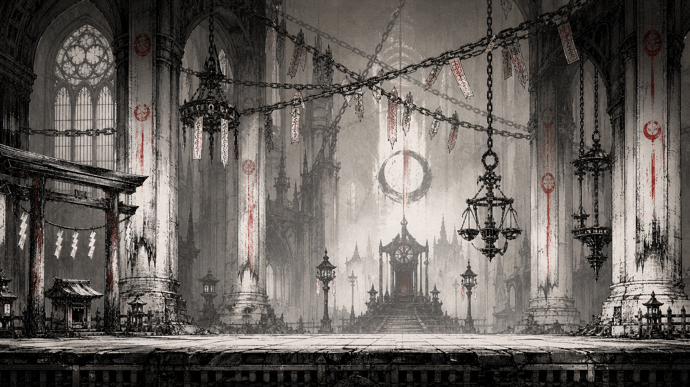
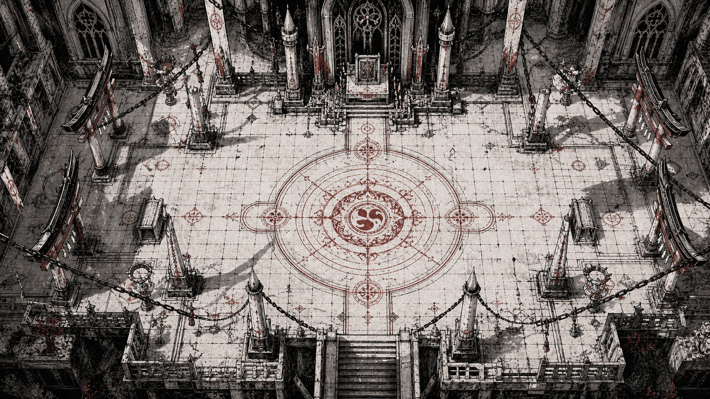

# Bakemono Monogatari

A Japanese-yokai 2D action roguelike built in a 12-hour TikTok hackathon with TypeScript and HTML5 Canvas 2D—centered on switching mid-fight between side-scrolling platforming and top-down bullet-dodging at the cost of your resurrection chance.

English · [简体中文](README.zh-CN.md) · [Play Online](https://zzzfu411.github.io/bakemono/)

| Vertical Plane (Side-Scrolling) | Unfolded Plane (Top-Down) |
| --- | --- |
|  |  |

## Gameplay

- **Dual-plane combat & Stigma Unfold** — Fight by default on a gravity-bound side-scrolling plane where room obstacles serve as platforms. Build 100 Stigma heat (dealing or taking hits) and press `E` to unfold a 20-second top-down arena with four-way movement where those same obstacles act as cover; taking any hit collapses the plane immediately, and each unfold costs `-1%` resurrection chance.
- **Probability resurrection** — Hitting `0` HP rolls against your current resurrection chance (`30%` base, modified by items, shop charms, and unfold penalties). Success revives you in place at full HP with `1s` invulnerability (`-2%` subsequent chance to prevent infinite loops); failure ends the run.
- **4 zones, 4 bosses & rubber-band scaling** — Clear 4 ten-room zones (*Giant Timber Woods* → *Weightless Clocktower* → *Ashen Graveplain* → *Cathedral Sanctum*), each with themed obstacle layouts, a dedicated boss, zone stat multipliers (up to `×2.40` HP / `×1.55` DMG), and extra scaling past player Lv.5.
- **Weapons, builds & Yumo Shop** — Combine 6 switchable weapons (each with a `Q` special), 18 player stats, 16 three-choice level-up cards, 14 passive items, 7 treasure room actions, and 6-slot shop encounters.

## Controls

| Input | Action |
| --- | --- |
| `W` `A` `S` `D` | Move (`W` jumps in vertical plane; 4-way movement when unfolded) |
| `Space` | Dash (up to 2 charges, `0.2s` invulnerability frames) |
| `Mouse Move` / `Left Click` | Aim cursor / Primary attack (hold for continuous fire) |
| `Q` / `R` | Weapon special skill / Cycle through 6 weapons |
| `E` | Unfold Stigma at 100 heat (press again to collapse early) |
| `1`–`6` | Quick-select level-up, treasure, or shop slot |
| `Esc` / `H` | Pause & inspect full stats and items / Open controls guide on title screen |

## Quick Start

Requires **Node.js 20+**. Built with **TypeScript 6** and **Vite 8** with zero runtime dependencies.

```bash
git clone https://github.com/zzzfu411/bakemono.git
cd bakemono
npm ci
npm run dev      # http://localhost:5173
```

Build a static production bundle (`dist/`, configured with relative `base: './'` for static hosting):

```bash
npm run build
npm run preview
```

## Project Structure

```text
src/
├── main.ts, game.ts, state.ts   Canvas initialization, main loop, room progression, and scaling state
├── player.ts, weapon.ts         Dual-plane physics, dash i-frames, 6 weapons, and Q specials
├── enemy.ts, room.ts            7 yokai archetypes, 4 zone bosses, and procedural room/obstacle layouts
├── leveling.ts, items.ts        Level-up cards, passive items, treasure events, and Yumo Shop logic
└── ui.ts, spritesheet.ts        DOM HUD/modals, sprite-frame animation, and fold transition effects
public/assets/                   Character/boss spritesheets, dual-plane backgrounds, and art manifests
```

## Credits & License

Source code is licensed under MIT (Zhi Fu). Visual assets were generated with AI models and post-processed into sprite sheets; see [CREDITS.md](CREDITS.md) for asset manifests and attribution details.
