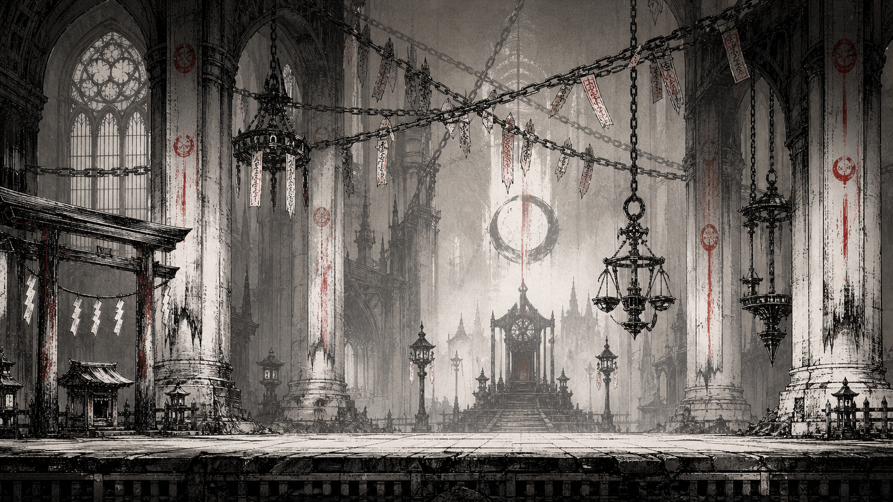
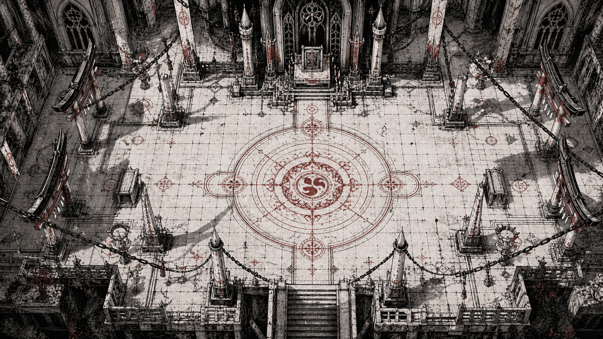

# 怪物物语 (Bakemono Monogatari)

12 小时 TikTok Hackathon 期间使用 TypeScript 与原生 Canvas 2D 构建的日式妖怪动作 Roguelike：围绕横版跳跃与俯视走位的双平面切换，以及消耗原地重生概率的「妖纹展开」博弈展开。

[English](README.md) · 简体中文

| 纵平面（横版重力作战） | 横平面（妖纹展开俯视） |
| --- | --- |
|  |  |

## 核心玩法

- **双平面切换与妖纹展开** — 默认在受重力约束的「纵平面」作战，房间障碍物充当跳跃平台；攻击与受击攒满 `100` 点圣痕热度后按 `E` 触发 20 秒「妖纹展开」，切入四向自由位移的俯视「横平面」，同一批障碍物随之变为掩体。展开期间受击即刻坍缩，且每次展开永久扣除 `1%` 原地重生概率。
- **概率原地重生** — 生命值归零时按当前重生概率（初始 `30%`，受展开扣减、道具与商店符箓影响）掷骰：命中则原地满血复活并获 `1` 秒无敌（后续重生率 `-2%` 以防无限续命），未命中则本局结束。
- **四区十房与双轴难度曲线** — 依次推进巨木薄林、失重钟楼、灰海墓原、教会圣城 4 个区域（每区 10 房 + 独立 Boss 与专属地形）；怪物属性按区域倍率（最高 `×2.40` 生命 / `×1.55` 伤害）与玩家 5 级后的等级动态叠加成长。
- **武器与局内构筑** — 提供 6 把可循环切换的武器（各带独立 `Q` 特殊技）、18 项角色属性、16 种升级三选一卡牌、14 件携带道具、7 类宝箱交互及「余墨堂」6 槽商店。

## 操作说明

| 按键 | 动作 |
| --- | --- |
| `W` `A` `S` `D` | 移动（纵平面 `W` 跳跃；横平面四向移动） |
| `Space` | 冲刺（最多 2 段，附 `0.2s` 无敌帧） |
| 鼠标移动 / 左键 | 瞄准方向 / 普通攻击（按住连发） |
| `Q` / `R` | 释放当前武器特殊技 / 循环切换 6 把武器 |
| `E` | 圣痕满 `100` 后展开妖纹；展开中再按可主动坍缩 |
| `1`–`6` | 快速选择升级卡牌、宝箱选项或商店槽位 |
| `Esc` / `H` | 暂停并查看完整属性与已携道具 / 在标题画面打开操作指南 |

## 快速开始

环境要求：**Node.js 20+**。基于 **TypeScript 6** + **Vite 8** 构建，零运行时外部依赖。

```bash
git clone https://github.com/zzzfu411/bakemono.git
cd bakemono
npm ci
npm run dev      # http://localhost:5173
```

构建生产静态产物（输出至 `dist/`，已配置相对路径 `base: './'`，可直接托管至任意静态服务器）：

```bash
npm run build
npm run preview
```

## 目录结构

```text
src/
├── main.ts, game.ts, state.ts   画布初始化、主循环、房间推进与双轴难度缩放状态
├── player.ts, weapon.ts         双平面物理、冲刺无敌帧、6 把武器与 Q 特殊技
├── enemy.ts, room.ts            7 类小怪、4 区 Boss 行为树及房间障碍生成
├── leveling.ts, items.ts        升级三选一、被动道具、宝箱事件与余墨堂商店逻辑
└── ui.ts, spritesheet.ts        DOM 浮层 HUD/弹窗、序列帧动画与妖纹展开过场
public/assets/                   角色/Boss 精灵图集、双平面背景与生成资产清单
```

## 署名与许可

代码部分由 Zhi Fu 编写并按 MIT 协议开源；美术素材由生成式 AI 产出并经裁切与帧序列处理，资产清单与来源说明详见 [CREDITS.md](CREDITS.md)。
